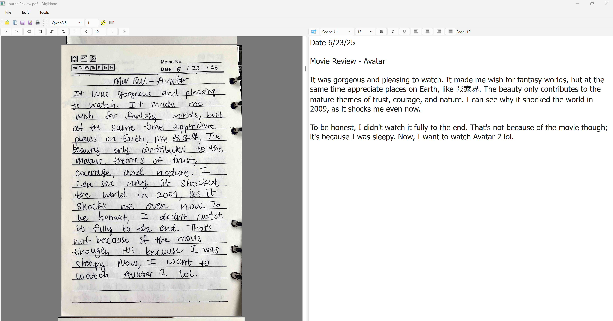
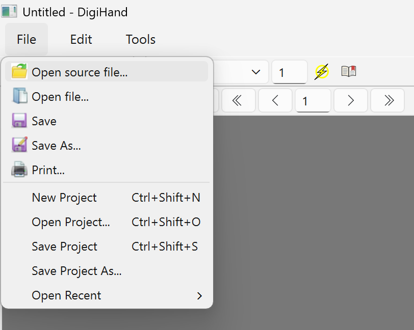
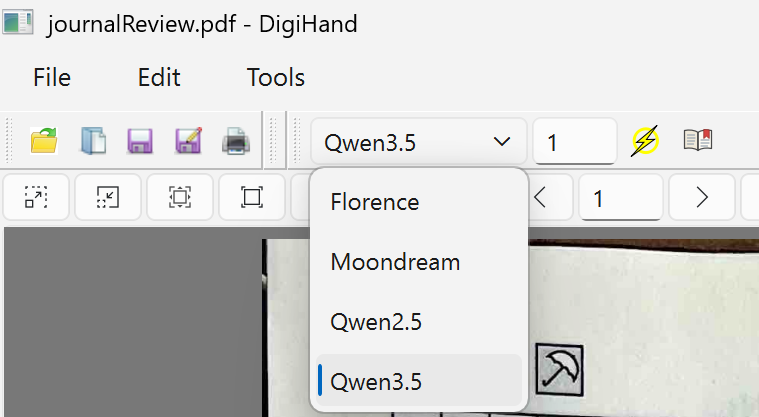
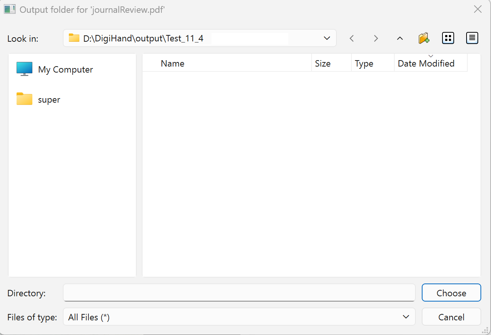
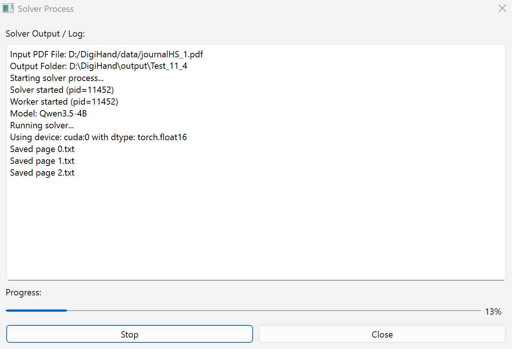
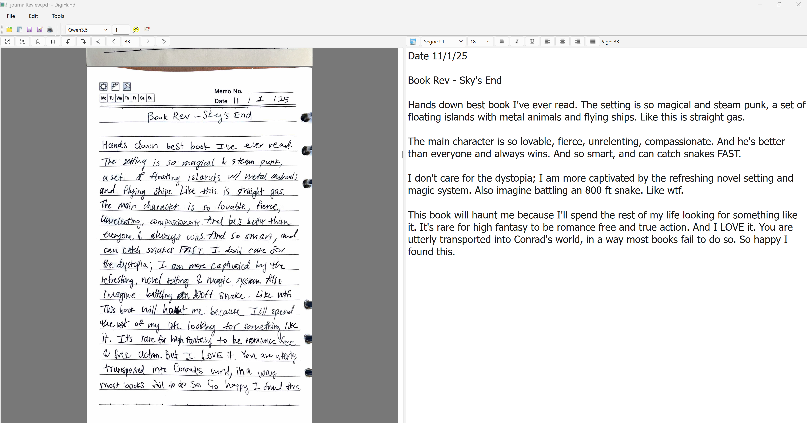
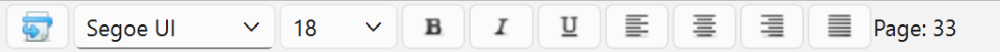
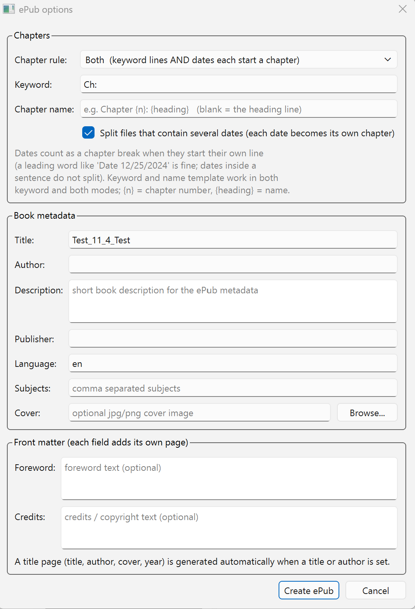
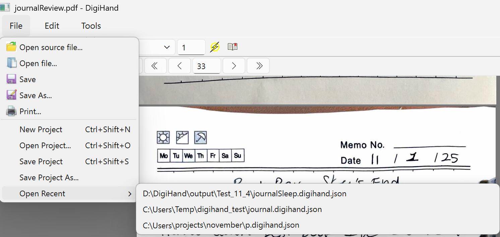

<h1 align="center">DigiHand</h1> 

Turning Chicken Scratch to Text, written in <b>Python</b>.

DigiHand is an innovative handwriting digitization platform that is powerful and easy to use, converting scanned PDFs of handwriting into digital text. After selecting a model, utilize its intuitive side-by-side editor to adjust raw output.

### The DigiHand window

- **Toolbars** — *File* (open PDF, save page, projects) and *Tools* (model picker, start page, Solve, ePub).
- **Left pane: PDF viewer** — your scanned source, with its own toolbar for page navigation, zoom, and rotation.
- **Right pane: Text Editor** — the recognized text for the current page, with a toolbar for font, size, and bold/italic/underline.

### Workflow

#### 1. Open your source PDF

Click **Open source file...** and choose the scanned PDF.

#### 2. Pick the model and start page

In the *Tools* toolbar, choose between the transcription models: Florence, Moondream, Qwen2.5, or Qwen3.5. The small number next to it is where you can change the **start page**, in case some pages have already been digitized.

*Model picker, starting page, Solve, and To ePub.*

#### 3. Choose where the text goes

Enter an existing folder or type a new folder name.

#### 4. Solve

Press **Solve**. Each page is saved as `page_0.txt`, `page_1.txt`, … in the output folder.

#### 5. Review each page

When the solver finishes, scroll through the PDF and use the synchronized text editor. Your edits save automatically when you switch pages.

### Reviewing tools

#### PDF viewer toolbar

- First page, Previous page, Next page, Last page, Custom Page Input.
- Zoom-in, Zoom-out, Fit-to-window, Original View.
- Rotate left, Rotate right.

#### Text editor toolbar

- Word wrap, Font, Font size, Formatting
- Bold, Italic, Underline

#### Keyboard shortcuts

| Shortcut | Action |
| --- | --- |
| `Ctrl+B` | Bold (in the text editor) |
| `Ctrl+I` | Italic |
| `Ctrl+U` | Underline |
| `Ctrl+Shift+N` | New project |
| `Ctrl+Shift+O` | Open project |
| `Ctrl+Shift+S` | Save project |

### Publish as an ePub

When finished reviewing, press the book-shaped **ePub** button. It then opens the ePub options window:

- **Chapter rule** — split chapters by *dates* (journal style: any date on its own line starts a chapter), by *keyword* (any line containing e.g. `Ch:`), or *both*.
- **Chapter name** — a template like `Chapter {n}: {heading}`; leave blank to use the heading line itself.
- **Split multi-date files** — when one text file contains several dates, each date becomes its own chapter.
- **Book metadata** — title, author, description, publisher, language, subjects, and an optional cover image.
- **Front matter** — optional foreword and credits pages.

Press **Create ePub**. The book is written next to your text files, and the status bar reports the ePub path plus a chapter log you can check.

### Data persistence

A DigiHand project remembers everything about a book-in-progress: the source PDF, the output folder, the chosen model, the start and current page, your window layout, your ePub options, and the epubs you generated.

- **File ▸ Save Project** (`Ctrl+Shift+S`) saves a `.digihand.json` beside your work; afterwards DigiHand autosaves it when you close.
- **File ▸ Open Project...** (`Ctrl+Shift+O`) or **Open Recent** reopens your past session.
- **File ▸ New Project** (`Ctrl+Shift+N`) clears the session for the next book.

### Tips & troubleshooting

- **First solve of a model is slow:** the model weights download once, then everything is local and offline.
- **Resuming a book:** set the start page number and press Solve again.
- **Epubs missing on disk after moving folders:** the project loads and tells you how many epubs it can't find.

## Hardware Acceleration

DigiHand supports CUDA on Windows and Linux. 

### CUDA

CUDA 13.3 requires an NVIDIA Turing-class or newer GPU and an R610 or newer driver. Check NVIDIA's official [CUDA toolkit, driver, and architecture matrix](https://docs.nvidia.com/datacenter/tesla/drivers/cuda-toolkit-driver-and-architecture-matrix.html) and install the [latest NVIDIA driver](https://www.nvidia.com/en-us/drivers/).

### CPU

CPU inference is available for supported workloads but is substantially slower.

## Models Available:
- Qwen 3.5
- Qwen 2.5
- Florence2
- Moondream2
